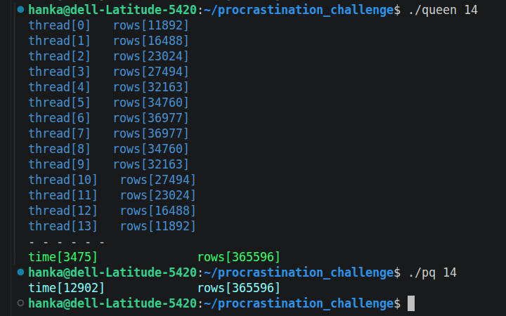
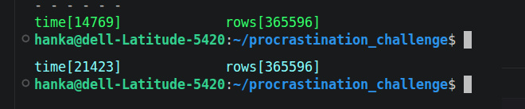
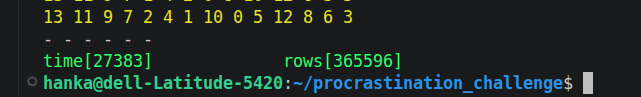

# THREAD CHALLENGE

*this project is a II.(and final) part of my recovery from minishell*

## Challenge

you have to take one task - whitch take a lot of time to computing - and divide the work to multiple threads

[i choose n_queen problem]

!!! you have to write your code with no AI usage as possible !!!

## Purpose

This task should demonstrate if is useful to divide task between multiple threads

## Usage

compile: make

start: ./queen [number > 3]

example: queen 10

!!! writes only computing time + number of results for every single thread !!!

### Comparision

n_queen_reference.c  - n_queen task working with only 1 thread 

[https://github.com/tdanielsousa/42_school_new_exams_2026/tree/main/Rank_3/level2/n_queens]

compile: gcc n_queen_reference.c -o nq 

use: ./nq [number > 3]

example: ./nq 5

writes only computing time + count results, takes a little more time for computing

computing time for 14x14 with no printf:

Comparision - computing time for 14x14 board with printing every result separately - good time but not sorted results:

Also tried version with structure (it's not here) - not good idea  - sorted results but extra long time - maybe with better memory allocation? (14 x 14 board)

## Print version

If you want version with printf, uncomment queen.c [line47]  and n_queen_reference.c [line74]

## Sources

https://broman.dev/download/The%20Linux%20Programming%20Interface.pdf

https://www.codequoi.com/en/tags/thread/

https://code-vault.net/course/6q6s9eerd0:1609007479575

## Ai usage

Ai used in final state of my coding - for finding bugs: 

- Race conditions: [board] is a single shared global array overwritten concurently by all threads without per-thread isolation
- Inicialization bug - pointer (data -> i) modified only first element instead of indexing data[i]

## Conclusion

It's good idea to divide job between multiple threads - but it didn't work extra fast if i had a lot of results to print